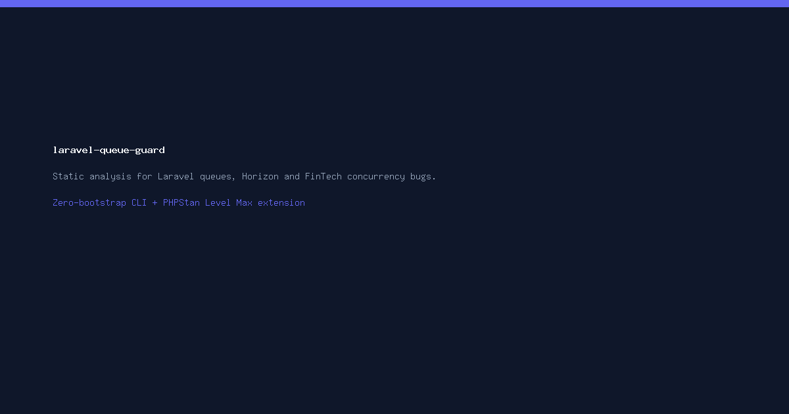

# Laravel Queue Guard

<p align="center">
  
</p>

<p align="center">
  <a href="https://packagist.org/packages/malikad/laravel-queue-guard"></a>
  <a href="https://packagist.org/packages/malikad/laravel-queue-guard"></a>
  <a href="https://github.com/malikad778/laravel-queue-guard/actions"></a>
  <a href="https://phpstan.org"></a>
  <a href="LICENSE.md"></a>
</p>

> **Static analysis for Laravel queues, Horizon workers, and FinTech concurrency bugs.**  
> Zero-bootstrap CLI tool and PHPStan extension. Detects double-charges, lock-holding HTTP requests, orphaned batches, race conditions, and uncommitted transaction dispatches before deployment.

---

## Table of Contents

- [Overview & Why Queue Guard?](#overview--why-queue-guard)
- [Key Features](#key-features)
- [Rules & Incident Detection Reference](#rules--incident-detection-reference)
  - [QG001: HTTP Call Inside Database Transaction](#qg001-http-call-inside-database-transaction)
  - [QG002: Non-Idempotent Financial Job With Retries](#qg002-non-idempotent-financial-job-with-retries)
  - [QG003: Missing SerializesModels Trait on Queued Class](#qg003-missing-serializesmodels-trait-on-queued-class)
  - [QG004: Unbounded Job Timeout or Missing Retry Policy](#qg004-unbounded-job-timeout-or-missing-retry-policy)
  - [QG005: Bus Batch or Chain Without Finally Callback](#qg005-bus-batch-or-chain-without-finally-callback)
  - [QG006: Synchronous Dispatch Inside Loop](#qg006-synchronous-dispatch-inside-loop)
  - [QG007: Queue Dispatch Inside Database Transaction](#qg007-queue-dispatch-inside-database-transaction)
  - [QG008: Queue retry_after Less Than Job Timeout](#qg008-queue-retry_after-less-than-job-timeout)
  - [QG009: HTTP Request or Session Context in Queued Job](#qg009-http-request-or-session-context-in-queued-job)
- [Installation](#installation)
- [Usage Modes](#usage-modes)
  - [1. Standalone CLI (Zero-Bootstrap)](#1-standalone-cli-zero-bootstrap)
  - [2. PHPStan Extension](#2-phpstan-extension)
- [Automated Code Fixes (`--fix`)](#automated-code-fixes---fix)
- [Baseline for Legacy Applications](#baseline-for-legacy-applications)
- [Configuration Reference](#configuration-reference)
- [Exemptions (`@queue-safe`)](#exemptions-queue-safe)
- [CI/CD Integration & Reporting](#cicd-integration--reporting)
  - [GitHub Actions Composite Action](#github-actions-composite-action)
  - [GitHub Actions Manual Step](#github-actions-manual-step)
  - [GitLab CI](#gitlab-ci)
  - [Supported Reporters](#supported-reporters)
- [Performance & Architecture](#performance--architecture)
- [Comparison: Queue Guard vs Larastan vs Pest](#comparison-queue-guard-vs-larastan-vs-pest)
- [Frequently Asked Questions (FAQ)](#frequently-asked-questions-faq)
- [Contributing & Testing](#contributing--testing)
- [License](#license)

---

## Overview & Why Queue Guard?

Laravel queues and background workers power mission-critical tasks: processing payments, syncing third-party APIs, generating invoices, and notifying users. However, standard unit tests and general-purpose static analyzers (like PHPStan or Psalm) treat queue jobs as regular synchronous PHP methods.

They cannot detect asynchronous failure modes such as:
1. **Network calls holding row locks**: Making an HTTP request inside `DB::transaction()` holds database row locks across remote network latency, triggering deadlocks and database connection pool exhaustion.
2. **Worker retry double-charges**: When a payment gateway times out on a retried job, the worker executes again without an idempotency key, charging customers multiple times.
3. **Transaction race conditions**: Fast workers dequeue jobs before the parent database transaction commits, resulting in `ModelNotFoundException` or executing with stale database records.
4. **Worker duplicate execution**: If `retry_after` in `config/queue.php` is lower than a job `$timeout`, Horizon or Redis assumes the worker died and releases the job to a second worker while the first worker is still actively processing it.
5. **Memory bloat and state pollution**: Passing Eloquent models into queued jobs without the `SerializesModels` trait serializes full model relations into Redis, consuming megabytes per job payload.

**Queue Guard solves these problems statically at compile/build time.** It parses the Abstract Syntax Tree (AST) directly without booting Laravel, connecting to databases, or requiring external services.

---

## Key Features

- **Zero-Bootstrap Architecture**: Runs in milliseconds via pure AST analysis using `nikic/php-parser`. Does not boot Laravel or instantiate service providers.
- **Dual-Mode Engine**: Use it as an independent standalone CLI (`vendor/bin/queue-guard`) or as a first-class PHPStan rule extension (`extension.neon`).
- **Safe Automated Fixes (`--fix`)**: AST-aware refactorings that insert `SerializesModels`, append `->afterCommit()` to uncommitted transaction dispatches, and stub typed `Batch` handlers.
- **FinTech & Concurrency Protections**: Dedicated safeguards for Stripe, payment gateways, ledger updates, idempotency keys, and database locking.
- **Horizon & Queue Configuration Cross-Validation**: Statically evaluates `config/queue.php` and `config/horizon.php` to prevent timeout-to-retry mismatches.
- **7 CI Reporters**: Native output for console, GitHub Actions annotations, SARIF (GitHub Code Scanning), GitLab Code Quality, JUnit, Checkstyle, and JSON.
- **Fingerprinted Baseline**: Incrementally introduce Queue Guard to large legacy repositories without blocking existing builds.

---

## Rules & Incident Detection Reference

Every rule in Queue Guard targets real, documented production incidents.

| Rule ID | Severity | Name | Production Consequence Prevented | Autofix |
|:---:|:---:|---|---|:---:|
| **QG001** | `error` | `HttpInsideTransaction` | Remote network calls holding row locks and exhausting pool connections | No |
| **QG002** | `error` | `NonIdempotentFinancialJob` | Worker retry double-charging or duplicate ledger mutations | No |
| **QG003** | `error` | `MissingSerializesModels` | Massive Redis payloads and stale un-refreshed model state | Yes |
| **QG004** | `warning` | `UnboundedJobTimeout` | Daemon worker hanging indefinitely on frozen external APIs | No |
| **QG005** | `warning` | `BatchWithoutFinally` | Failed child job leaving parent workflow stuck in an orphaned state | Yes |
| **QG006** | `warning` | `SyncDispatchInLoop` | N network round-trips to Redis or database instead of bulk dispatch | No |
| **QG007** | `error` | `DispatchInsideTransaction` | Worker race condition where job runs before transaction commits | Yes |
| **QG008** | `error` | `RetryAfterTimeoutMismatch` | Queue worker duplicate concurrent execution due to low `retry_after` | No |
| **QG009** | `error` | `RequestContextInQueuedClass` | CLI workers referencing null or stale HTTP request/session state | No |

---

### QG001: HTTP Call Inside Database Transaction

- **PHPStan Identifier**: `queueGuard.httpInsideTransaction`
- **Default Severity**: `error`
- **Incident Description**: When HTTP calls (Laravel `Http` facade, Guzzle, cURL, Mailer, external SDKs) run inside `DB::transaction()`, database locks acquired before the call remain held until the remote server responds. A slow 3-second API response locks database rows for 3 seconds, causing connection starvation and deadlocks across the entire application.

#### Bad Code
```php
DB::transaction(function () use ($order) {
    $order->update(['status' => 'processing']);

    // BAD: Remote HTTP call keeps row lock open during network latency
    Http::post('https://api.fulfillment.com/orders', [
        'order_id' => $order->id,
    ]);
});
```

#### Good Code
```php
DB::transaction(function () use ($order) {
    $order->update(['status' => 'processing']);

    // GOOD: Dispatches network I/O only after database transaction commits
    DB::afterCommit(function () use ($order) {
        Http::post('https://api.fulfillment.com/orders', [
            'order_id' => $order->id,
        ]);
    });
});
```

---

### QG002: Non-Idempotent Financial Job With Retries

- **PHPStan Identifier**: `queueGuard.nonIdempotentFinancialJob`
- **Default Severity**: `error`
- **Incident Description**: Queued jobs with retries (`$tries > 1` or unconfigured bounded tries) that perform financial mutations (Stripe, Cashier, payment gateways, wallet adjustments) without an idempotency key or prior status guard. If an API call succeeds but the response drops due to network failure, the worker retries the job and charges the customer a second time.

#### Bad Code
```php
class ProcessPaymentJob implements ShouldQueue
{
    public int $tries = 3;

    public function handle(): void
    {
        // BAD: If the network drops after charging, retry double-charges customer
        \Stripe\PaymentIntent::create([
            'amount' => 5000,
            'currency' => 'usd',
            'customer' => $this->customerId,
        ]);
    }
}
```

#### Good Code
```php
class ProcessPaymentJob implements ShouldQueue
{
    public int $tries = 3;

    public function handle(): void
    {
        // GOOD: Supplies idempotency key so retries return existing intent safely
        \Stripe\PaymentIntent::create([
            'amount' => 5000,
            'currency' => 'usd',
            'customer' => $this->customerId,
        ], [
            'idempotency_key' => 'order_' . $this->orderId,
        ]);
    }
}
```

---

### QG003: Missing SerializesModels Trait on Queued Class

- **PHPStan Identifier**: `queueGuard.missingSerializesModels`
- **Default Severity**: `error`
- **Incident Description**: Any queued class (Job, Mailable, Notification, Listener) whose constructor accepts an Eloquent model or Eloquent collection, but lacks the `\Illuminate\Queue\SerializesModels` trait. Without this trait, PHP serializes the entire in-memory model object and all loaded relations into Redis or database queues, causing payload bloat and reading stale data when executed.

#### Bad Code
```php
class SendOrderInvoice implements ShouldQueue
{
    // BAD: Missing SerializesModels trait
    public function __construct(public Order $order) {}

    public function handle(): void
    {
        // ...
    }
}
```

#### Good Code
```php
use Illuminate\Queue\SerializesModels;

class SendOrderInvoice implements ShouldQueue
{
    use SerializesModels;

    // GOOD: Stores only model ID; re-hydrates clean model from DB when executed
    public function __construct(public Order $order) {}

    public function handle(): void
    {
        // ...
    }
}
```
*Autofix available: `vendor/bin/queue-guard analyse app --fix` inserts the trait automatically.*

---

### QG004: Unbounded Job Timeout or Missing Retry Policy

- **PHPStan Identifier**: `queueGuard.unboundedJobTimeout`
- **Default Severity**: `warning`
- **Incident Description**: Queued jobs with no `$timeout` property, no `timeout()` method, and no `retryUntil()` deadline. If the job enters a frozen socket read or infinite loop, the worker daemon is blocked indefinitely until manually killed. Note: `$backoff` delays retries, but does not bound them.

#### Bad Code
```php
class SyncCatalogJob implements ShouldQueue
{
    // BAD: No timeout and no bounded retries configured
    public function handle(): void
    {
        // Network calls here can hang the worker indefinitely
    }
}
```

#### Good Code
```php
class SyncCatalogJob implements ShouldQueue
{
    public int $timeout = 120; // 2 minutes maximum execution
    public int $tries = 3;     // 3 attempts maximum

    public function handle(): void
    {
        // ...
    }
}
```

---

### QG005: Bus Batch or Chain Without Finally Callback

- **PHPStan Identifier**: `queueGuard.batchWithoutFinally`
- **Default Severity**: `warning`
- **Incident Description**: Creating batch workflows using `Bus::batch([...])` without registering `finally()` or `catch()` callbacks. If one child job fails permanently, the batch completes in a failed state but the parent application is never notified, leaving user records stuck in "Pending".

#### Bad Code
```php
Bus::batch([
    new ProcessImage($image1),
    new ProcessImage($image2),
])->dispatch(); // BAD: If a job fails, workflow is orphaned with no cleanup
```

#### Good Code
```php
Bus::batch([
    new ProcessImage($image1),
    new ProcessImage($image2),
])->then(function (\Illuminate\Bus\Batch $batch) {
    // All jobs succeeded
})->catch(function (\Illuminate\Bus\Batch $batch, Throwable $e) {
    // First batch failure detected
})->finally(function (\Illuminate\Bus\Batch $batch) {
    // Always runs on batch completion or failure
})->dispatch();
```
*Autofix available: `vendor/bin/queue-guard analyse app --fix` inserts a typed `finally` stub.*

---

### QG006: Synchronous Dispatch Inside Loop

- **PHPStan Identifier**: `queueGuard.syncDispatchInLoop`
- **Default Severity**: `warning`
- **Incident Description**: Invoking `dispatchSync()`, `notifyNow()`, or individual queue dispatches inside loops or `chunk()` callbacks. Processing records synchronously in a loop blocks the active request and causes N separate network round-trips to Redis or databases instead of batch operations.

#### Bad Code
```php
foreach ($users as $user) {
    // BAD: Executes synchronously inside HTTP request loop
    ProcessStatement::dispatchSync($user);
}
```

#### Good Code
```php
// GOOD: Dispatch as asynchronous batch or bulk collection
$jobs = $users->map(fn ($user) => new ProcessStatement($user))->all();
Bus::batch($jobs)->dispatch();
```

---

### QG007: Queue Dispatch Inside Database Transaction

- **PHPStan Identifier**: `queueGuard.dispatchInsideTransaction`
- **Default Severity**: `error`
- **Incident Description**: Dispatching asynchronous jobs inside `DB::transaction()` without specifying `afterCommit`. Because queue workers run independently and fast, a worker frequently picks up the dispatched job from Redis before the database transaction commits. When the worker tries to query `User::findOrFail($id)`, it throws `ModelNotFoundException` because the record does not exist in the database yet.

#### Bad Code
```php
DB::transaction(function () use ($data) {
    $user = User::create($data);

    // BAD: Worker can pick up job before commit finishes; $user not found!
    SendWelcomeEmail::dispatch($user);
});
```

#### Good Code
```php
DB::transaction(function () use ($data) {
    $user = User::create($data);

    // GOOD: Dispatches to queue only after database transaction commits
    SendWelcomeEmail::dispatch($user)->afterCommit();
});
```
*Autofix available: `vendor/bin/queue-guard analyse app --fix` appends `->afterCommit()` to dispatches inside transaction closures.*

---

### QG008: Queue retry_after Less Than Job Timeout

- **PHPStan Identifier**: `queueGuard.retryAfterTimeoutMismatch`
- **Default Severity**: `error`
- **Incident Description**: A job specifies a `$timeout` that is greater than or equal to the connection `retry_after` setting in `config/queue.php`. When a job runs longer than `retry_after`, the queue driver (Redis, database) assumes the worker crashed and releases the job back to the queue. A second worker starts executing the job simultaneously while the first worker is still running, causing duplicate processing and race conditions.

#### Bad Configuration & Job
```php
// config/queue.php:
'connections' => [
    'redis' => [
        'driver' => 'redis',
        'retry_after' => 90, // Queue releases job after 90 seconds
    ],
],

// app/Jobs/GenerateReportJob.php:
class GenerateReportJob implements ShouldQueue
{
    // BAD: 180s timeout > 90s retry_after!
    // Job will be handed to a second worker while first is still running!
    public int $timeout = 180;
}
```

#### Good Configuration & Job
```php
// config/queue.php:
'connections' => [
    'redis' => [
        'driver' => 'redis',
        'retry_after' => 300, // 5 minutes retry buffer
    ],
],

// app/Jobs/GenerateReportJob.php:
class GenerateReportJob implements ShouldQueue
{
    // GOOD: Job timeout is well below queue retry_after buffer
    public int $timeout = 120;
}
```

---

### QG009: HTTP Request or Session Context in Queued Job

- **PHPStan Identifier**: `queueGuard.requestContextInQueuedClass`
- **Default Severity**: `error`
- **Incident Description**: Calling `request()`, `Request::get()`, `Auth::user()`, `session()`, or `url()->current()` inside a queued class `handle()` method. Queued workers run inside long-lived CLI processes (CLI daemon) where the original HTTP request does not exist. Calling these methods returns `null`, throws exceptions, or leaks stale state from previously processed jobs.

#### Bad Code
```php
class ProcessInvoiceJob implements ShouldQueue
{
    public function handle(): void
    {
        // BAD: In CLI daemon worker, request() has no request URL or headers
        $ip = request()->ip();

        // BAD: Session is not bound to worker CLI process
        $userId = session('authenticated_user');
    }
}
```

#### Good Code
```php
class ProcessInvoiceJob implements ShouldQueue
{
    // GOOD: Capture request data in the controller and pass via constructor
    public function __construct(
        public int $userId,
        public string $clientIp,
    ) {}

    public function handle(): void
    {
        // Use constructor properties directly
    }
}
```

---

## Installation

Install Queue Guard in your project as a development dependency via Composer:

```bash
composer require --dev malikad/laravel-queue-guard
```

Requirements:
- PHP 8.1, 8.2, 8.3, or 8.4
- Laravel 9.x, 10.x, 11.x, or 12.x (optional: runs standalone on any PHP project)
- PHPStan 1.12+ or 2.x (if using the PHPStan extension mode)

---

## Usage Modes

Queue Guard provides two flexible modes of operation. You can use either mode, or both together in your workflow.

### 1. Standalone CLI (Zero-Bootstrap)

Run analysis directly in your terminal or CI environment without booting the Laravel application:

```bash
# Analyse the default paths configured in config/queue-guard.php (app)
vendor/bin/queue-guard analyse

# Analyse specific directories or files
vendor/bin/queue-guard analyse app/Jobs app/Services

# The 'analyse' command name can be omitted when passing paths
vendor/bin/queue-guard app/Jobs

# Exit with failure on warnings as well as errors
vendor/bin/queue-guard analyse app --fail-on=warning

# Output in JSON format
vendor/bin/queue-guard analyse app --format=json

# Output in SARIF format for GitHub Code Scanning
vendor/bin/queue-guard analyse app --format=sarif > results.sarif

# Explain any rule with bad/good examples and rationale
vendor/bin/queue-guard explain QG001

# List all available rules and default severities
vendor/bin/queue-guard list-rules

# Scaffold the configuration file
vendor/bin/queue-guard init
```

### 2. PHPStan Extension

If you use `phpstan/extension-installer`, Queue Guard registers automatically.

Otherwise, include `extension.neon` in your `phpstan.neon`:

```neon
includes:
    - vendor/malikad/laravel-queue-guard/extension.neon

parameters:
    queueGuard:
        externalCallClasses:
            - App\Services\PaymentGateway
            - Twilio\Rest\Client
        financialCallClasses:
            - App\Services\WalletLedger
```

When you run PHPStan, all Queue Guard detectors run seamlessly alongside standard type checks:

```bash
vendor/bin/phpstan analyse
```

---

## Automated Code Fixes (`--fix`)

Queue Guard includes built-in AST fixers that safely rectify common mistakes without altering surrounding code:

- **QG003 Fixer**: Automatically imports and adds `use \Illuminate\Queue\SerializesModels;` to queued classes accepting Eloquent models.
- **QG005 Fixer**: Appends a typed `finally(function (\Illuminate\Bus\Batch $batch) { ... })` handler to orphaned batches.
- **QG007 Fixer**: Appends `->afterCommit()` to uncommitted queue dispatches inside database transactions.

Run the fixer using:

```bash
vendor/bin/queue-guard analyse app --fix
```

Fixers are idempotent, respect `@queue-safe` exemptions, and only modify files containing resolvable findings.

---

## Baseline for Legacy Applications

Introducing strict static analysis to an established enterprise codebase can yield hundreds of legacy findings. Queue Guard includes a robust baseline system that records existing findings so your team can enforce strict rules on all newly written code immediately.

```bash
# Generate a new baseline file
vendor/bin/queue-guard baseline

# Specify a custom baseline location
vendor/bin/queue-guard baseline --path=queue-guard-baseline.json
```

Baseline features:
- **Fingerprinted Entries**: Tracks rule ID, normalized file path, message hash, and occurrence index, allowing multiple identical findings in the same file to be baselined accurately.
- **Pruning Stale Entries**: As legacy findings are resolved, the baseline can be refreshed cleanly.

---

## Configuration Reference

Initialize a project configuration file:

```bash
vendor/bin/queue-guard init
```

This generates `config/queue-guard.php`:

```php
<?php

declare(strict_types=1);

return [
    /*
    |--------------------------------------------------------------------------
    | Scanned Paths
    |--------------------------------------------------------------------------
    | Directories or files to scan during analysis.
    */
    'paths' => [
        'app',
    ],

    /*
    |--------------------------------------------------------------------------
    | Excluded Paths
    |--------------------------------------------------------------------------
    | Patterns or directories ignored during analysis.
    */
    'exclude' => [
        'tests',
        'vendor',
    ],

    /*
    |--------------------------------------------------------------------------
    | Rules Configuration
    |--------------------------------------------------------------------------
    | Enable or disable individual rules and customize severity levels
    | ('error', 'warning', 'info'). Set rule value to false to disable.
    */
    'rules' => [
        'QG001' => ['enabled' => true, 'severity' => 'error'],
        'QG002' => ['enabled' => true, 'severity' => 'error'],
        'QG003' => ['enabled' => true, 'severity' => 'error'],
        'QG004' => ['enabled' => true, 'severity' => 'warning'],
        'QG005' => ['enabled' => true, 'severity' => 'warning'],
        'QG006' => ['enabled' => true, 'severity' => 'warning'],
        'QG007' => ['enabled' => true, 'severity' => 'error'],
        'QG008' => ['enabled' => true, 'severity' => 'error'],
        'QG009' => ['enabled' => true, 'severity' => 'error'],
    ],

    /*
    |--------------------------------------------------------------------------
    | Custom External Call Classes (QG001)
    |--------------------------------------------------------------------------
    | Additional classes or interfaces that perform external I/O.
    */
    'externalCallClasses' => [
        // App\Services\PaymentGateway::class,
    ],

    /*
    |--------------------------------------------------------------------------
    | Custom Financial Classes (QG002)
    |--------------------------------------------------------------------------
    | Additional domain classes performing balance updates or money movements.
    */
    'financialCallClasses' => [
        // App\Services\LedgerService::class,
    ],

    /*
    |--------------------------------------------------------------------------
    | Analysis Options
    |--------------------------------------------------------------------------
    */
    'maxCallDepth' => 2,
    'baseline' => null,
    'failOn' => 'error',
    'format' => 'console',
];
```

---

## Exemptions (`@queue-safe`)

When an intentional architectural decision requires bypassing a rule, use the `@queue-safe` docblock annotation.

### Granular Rule Exemption
```php
/** @queue-safe QG001 */
DB::transaction(function () {
    // Only QG001 is exempted; other rules still apply
    Http::post('https://internal-daemon.local/notify');
});
```

### Multiple Rules Exemption
```php
/** @queue-safe QG001,QG007 */
public function performAtomicSync(): void
{
    // QG001 and QG007 are exempted
}
```

### Universal Exemption
```php
/** @queue-safe */
public function legacyBillingRoutine(): void
{
    // All Queue Guard rules are exempted for this method
}
```

### PHPStan Mode Exemption
When running under PHPStan, you can also use standard PHPStan ignore annotations:
```php
// @phpstan-ignore queueGuard.httpInsideTransaction
Http::post('https://api.example.com');
```

---

## CI/CD Integration & Reporting

### GitHub Actions Composite Action

Queue Guard provides a first-class GitHub Action (`action.yml`):

```yaml
name: Queue Guard

on:
  push:
    branches: [main]
  pull_request:
    branches: [main]

jobs:
  queue-guard:
    runs-on: ubuntu-latest
    steps:
      - name: Checkout Code
        uses: actions/checkout@v4

      - name: Setup PHP
        uses: shivammathur/setup-php@v2
        with:
          php-version: '8.3'
          coverage: none

      - name: Install Dependencies
        run: composer install --prefer-dist --no-progress

      - name: Run Queue Guard
        uses: malikad778/laravel-queue-guard@main
        with:
          paths: app
          fail-on: error
          format: github
```

### GitHub Actions Manual Step

If you prefer invoking the binary directly:

```yaml
- name: Run Queue Guard CLI
  run: vendor/bin/queue-guard analyse app --format=github --fail-on=error
```

### GitLab CI

Export findings directly into the GitLab Code Quality widget:

```yaml
queue_guard:
  stage: test
  image: php:8.3-cli
  before_script:
    - composer install --prefer-dist --no-progress
  script:
    - vendor/bin/queue-guard analyse app --format=gitlab > gl-code-quality-report.json
  artifacts:
    reports:
      codequality: gl-code-quality-report.json
```

### Supported Reporters

| Format Name | Flag | Description | Ideal Use Case |
|---|---|---|---|
| **Console** | `--format=console` | High-contrast colored terminal output with tips and docs URLs | Local developer workflow |
| **GitHub** | `--format=github` | Emits GitHub workflow annotations (`::error::`, `::warning::`) | Pull request checks |
| **SARIF** | `--format=sarif` | Standard SARIF v2.1.0 output | GitHub Code Scanning Security tab |
| **GitLab** | `--format=gitlab` | GitLab Code Quality JSON schema | GitLab CI/CD merge requests |
| **Checkstyle** | `--format=checkstyle` | XML output conforming to Checkstyle schema | PHPStorm, Jenkins, TeamCity |
| **JUnit** | `--format=junit` | Standard test suite JUnit XML | Azure DevOps, CircleCI |
| **JSON** | `--format=json` | Pure JSON payload with structured finding objects | Custom scripting and dashboards |

---

## Performance & Architecture

Queue Guard is engineered for exceptional speed and minimal overhead:

- **Direct AST Traversals**: Analyzes source files using PHP-Parser with optimized node visitors.
- **Zero Laravel Kernel Booting**: Avoids loading service providers, database connections, facades, or framework containers during analysis.
- **In-Memory Configuration Caching**: Reads and parses `config/queue.php` and `config/horizon.php` once and caches parsed values across the analysis run.
- **Sub-Second Execution**: Scans hundreds of application files in under 1 second.

---

## Comparison: Queue Guard vs Larastan vs Pest

| Feature | Laravel Queue Guard | Larastan (PHPStan) | Pest / PHPUnit |
|---|:---:|:---:|:---:|
| **Analysis Type** | Static AST Analysis | Static Type Checking | Dynamic Runtime Testing |
| **Boot Application Container** | No (0 ms startup) | Yes | Yes |
| **Detects HTTP inside DB::transaction()** | Yes (QG001) | No | No |
| **Detects Un-guarded Stripe Retries** | Yes (QG002) | No | No |
| **Detects Missing SerializesModels** | Yes (QG003) | No | Only if runtime serialized |
| **Validates retry_after vs $timeout** | Yes (QG008) | No | No |
| **Catches Transaction Dispatch Race** | Yes (QG007) | No | Only under concurrent load |
| **Automated Safe Code Fixes** | Yes (`--fix`) | No | No |

---

## Frequently Asked Questions (FAQ)

### Does Queue Guard connect to my live database or external APIs?
No. Queue Guard is a pure static analyzer. It never connects to databases, Redis, or external network APIs. It reads local PHP files and validates code logic ahead of time.

### Can I run Queue Guard on non-Laravel projects?
Yes. The standalone CLI works on any PHP application that utilizes background jobs, database transactions, or queues. Rule detectors gracefully skip rules that do not apply to non-Laravel constructs.

### What is the difference between QG001 and QG007?
- **QG001** flags external HTTP/network calls occurring inside a transaction, which keep database row locks held across network latency.
- **QG007** flags queue dispatches occurring inside a transaction without `afterCommit`, which risks a background worker reading database rows before the transaction finishes committing.

### How do I handle false positives?
Use the `/** @queue-safe <RuleId> */` docblock on the affected line or method, or generate a baseline file with `vendor/bin/queue-guard baseline`.

---

## Contributing & Testing

We welcome issues and pull requests.

```bash
# Clone the repository
git clone https://github.com/malikad778/laravel-queue-guard.git
cd laravel-queue-guard

# Install development dependencies
composer install

# Run the test suite
vendor/bin/phpunit

# Run PHPStan static analysis at Level Max
vendor/bin/phpstan analyse

# Check code formatting with Laravel Pint
vendor/bin/pint --test src config tests
```

---

## License

Laravel Queue Guard is open-sourced software licensed under the **[MIT License](LICENSE.md)**.
